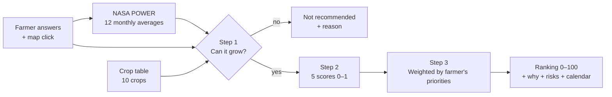

# Field Shift: how the crop recommendation works

**NASA Space Apps Challenge 2026 · "Field Shift: Adapting Farms with NASA Data"**

🌐 **Live app:** https://field-shift-omega.vercel.app
📂 **Code:** https://github.com/blurry-GJGF/Field-Shift. The algorithm is in [`lib/ranking.js`](lib/ranking.js), the crop table in [`lib/cultivos.js`](lib/cultivos.js) and the NASA POWER client in [`lib/nasa/power.js`](lib/nasa/power.js).

This document explains **how Field Shift decides which crop a farmer should plant next**, why we designed it this way, how we tested it, and where its limits are.

---

## 1. The question it answers

> *"Given my field, what I just harvested, the water I have and what matters to me, **which crop should I plant next, when, and why?**"*

The output is a **ranking of 10 crops**. Each crop comes with:
- a score from 0 to 100, also shown as a word (*Excellent*, *Good*, *Fair*, *Poor*);
- **when to plant and when to harvest**;
- **why** it was suggested (its strongest criteria);
- **risks** that a farmer or agronomist should review;
- the crops that **cannot** grow there, with the reason.

The tool **supports** the farmer's judgment. It does not replace it.

---

## 2. Inputs

### 2.1 What the farmer tells us (4 questions)
| Question | Used for |
|---|---|
| 📍 Where is your field? (click on the map) | Location for the NASA data |
| 🌾 What is planted now (or was last), and when was it planted? | When the field becomes free, and pest-cycle rotation |
| 🚿 How many times can you water your next crop? (None / 1–2 / 3–4 / 5+) | Irrigation water: ≈ 0 / 150 / 300 / 500 mm, assuming **~75 mm per watering** |
| ⭐ How important is saving water, healthier soil and income? (0–3 each) | The weight of each criterion |
| 🚫 Crops you can't or won't plant (optional) | Excluded from the ranking |

We ask about irrigation in **waterings**, not millimetres, because that is how farmers think about water.

### 2.2 What NASA tells us: NASA POWER
One request per field to the **NASA POWER Climatology API** (`community=AG`). It returns **long-term monthly averages for 2001–2025** from the **MERRA-2** reanalysis (grid of ~50 km).

| Parameter | Meaning | Used in |
|---|---|---|
| `T2M` | Mean air temperature at 2 m | Viability (is it warm enough to grow?) |
| `T2M_MIN` | **Coldest hour** typical of the month (POWER keeps the hourly extreme) | Viability (frost kill) |
| `T2M_MAX` | **Hottest hour** typical of the month | Climate score (heat stress) |
| `PRECTOTCORR` | Precipitation (mm/day → mm/month using days per month) | Viability and water score |
| `GWETTOP`, `GWETROOT`, `TS` | Surface and root-zone soil wetness, and land-surface temperature | Shown in the **Soil** view (not yet in the score, see §8) |

Missing values (POWER's `-999` fill value) are rejected rather than used as real data.

### 2.3 What we know about each crop
A table of **10 crops from 5 botanical families**: grasses (corn, wheat, sorghum, oats), legumes (beans, chickpea, faba bean), nightshade (chili), gourd (squash) and aster (sunflower).

| Field | Meaning | Example (chickpea) |
|---|---|---|
| `ciclo` | Months from planting to harvest | 5 |
| `aguaMm` | Water the crop needs over its cycle | 350 mm |
| `tMinCrecer` | Minimum mean temperature to grow | 5 °C |
| `tMaxLimite` | Temperature above which it suffers | 30 °C |
| `tMinTolerada` | Coldest night it survives (0 = frost-sensitive) | −4 °C |
| `familia` | Botanical family | legume |
| `fijaN` | Fixes nitrogen? | yes |
| `raiz` | Root depth | deep |
| `residuo` | Crop residue left | low |
| `valor` | Relative market value (0–1) | 0.8 |

⚠️ These are **approximate example values** based on FAO ECOCROP / FAO-56 style data. They must be validated with agronomists before real use (see §8).

---

## 3. Overview



---

## 4. The algorithm, step by step

### Step 0: When is the field free?
The field becomes free when the current crop is harvested:

```
free month = month it was planted + crop cycle
```
> Corn planted in **June** + 5 months → harvested in **October** → field free from **November**.

If that date has already passed, the field is free **today**.

### Step 1: Can it grow? (hard filter)
Starting from the month the field is free, we try **each of the next 12 months as a planting date**. For each one we look at **every month of the crop's cycle** and apply 3 rules in order:

| # | Rule | NASA data | Fails when |
|---|---|---|---|
| ① | **Frost** | `T2M_MIN` | Any month's coldest hour is below what the crop tolerates. Frost-sensitive crops die at ≤ 0 °C |
| ② | **Warm enough** | `T2M` | Any month's mean temperature is below `tMinCrecer` |
| ③ | **Enough water** | `PRECTOTCORR` + irrigation | `(0.8 × rain over the cycle + irrigation used) / water needed < 50 %` |

- Only **80 % of rain** counts as useful, because the rest runs off or evaporates.
- Irrigation is **only used as much as needed**: `irrigation used = min(available, need − useful rain)`.

The **next planting** is the **first month that passes the three rules**. The run of consecutive valid months after it is the **planting window**. If no month passes, the crop is listed as **not recommended**, with the reason (*frost*, *too cold* or *not enough water*).

👉 **Planting dates are computed from each location's climate, not taken from a fixed calendar.** This is why the same algorithm works in Sonora, Iowa or Argentina, including the southern hemisphere.

### Step 2: How good is it? (5 scores from 0 to 1)

| Criterion | Formula | Idea |
|---|---|---|
| 💧 **Water** | `coverage − 0.5 × (irrigation used / water needed)`, where `coverage = 1 − deficit / water needed` | Does water cover the crop's needs? **Using irrigation is penalised**: saving water means relying less on irrigation |
| 🌡️ **Climate** | `1 − 0.5 × (months with T2M_MAX > tMaxLimite) / cycle months` | Penalises heat stress during the cycle |
| 🌱 **Soil** | `0.30 if it fixes nitrogen` + `residue (0.20 high / 0.10 medium / 0)` + `roots (0.20 deep / 0.10 medium / 0)` + `0.30 × cycle / 12` (max 1) | Does it improve soil health? Nitrogen fixation, organic matter, root structure, time the soil is covered |
| 🐛 **Pests** | `1` if its family differs from the current crop, `0` if it is the same | Rotating families breaks pest and disease cycles. Not used when the field was empty |
| 💰 **Income** | `valor` from the crop table | Market value |

### Step 3: What matters to the farmer weighs more

```
score = 100 × Σ (weight × criterion score) / Σ weights
```

| Criterion | Weight |
|---|---|
| 💧 Water | farmer's answer (0–3) |
| 🌱 Soil | farmer's answer (0–3) |
| 💰 Income | farmer's answer (0–3) |
| 🌡️ Climate | 2 (fixed) |
| 🐛 Pests | 2 (fixed, only if something was planted) |

Crops are sorted by score. The first one is the **best pick**.

### Step 4: Explaining the result in plain language
Every number can be traced back to a piece of data, so the explanation is generated from the scores themselves:
- **Strongest:** the two highest criterion scores, which also feed the plain sentence (*"Plant chickpea this month: it adds natural nitrogen to your soil and breaks the pest cycle of your corn."*).
- **Risks:** any criterion below 0.6, months above the heat limit, irrigation needed (in waterings), months of waiting with bare soil, and "same family as your current crop".
- **Best month in the window:** if waiting a little inside the planting window would give a higher score, we say so.

---

## 5. Worked example: Valle del Yaqui, Sonora (27.49 N, 109.93 W)

### NASA POWER data (2001–2025 monthly averages)
| | Jan | Feb | Mar | Apr | May | Jun | Jul | Aug | Sep | Oct | Nov | Dec |
|---|---|---|---|---|---|---|---|---|---|---|---|---|
| Mean T (°C) | 18.0 | 18.9 | 21.4 | 24.1 | 27.4 | 31.3 | 30.9 | 30.4 | 29.7 | 26.7 | 22.4 | 18.1 |
| Coldest hour (°C) | 2.2 | **−0.4** | 8.4 | 9.6 | 12.9 | 19.1 | 23.7 | 23.4 | 19.6 | 9.7 | 4.6 | 3.4 |
| Hottest hour (°C) | 34.7 | 37.6 | 38.7 | 41.1 | 43.0 | 44.7 | 43.2 | 42.7 | 42.7 | 42.0 | 39.2 | 36.3 |
| Rain (mm) | 13 | 12 | 6 | 2 | 1 | 17 | 102 | 96 | 99 | 26 | 11 | 8 |

### Farmer's answers
- Just harvested **corn** (planted in June).
- Can water **3–4 times** (≈ 300 mm).
- Priorities: saving water **High (3)**, soil **Mid (2)**, income **Low (1)**.
- Date: November 2026.

### Chickpea, the best pick, computed by hand
**Step 1, planting in November (Nov–Mar):**
- ① **Frost:** the coldest hour is −0.4 °C (February), and chickpea tolerates −4 °C ✅ (corn would die here).
- ② **Warm enough:** all mean temperatures are ≥ 5 °C ✅
- ③ **Water:** rain = 11 + 8 + 13 + 12 + 6 = 50 mm → useful 40 mm. It needs 350 mm, so it uses 300 mm of irrigation → (40 + 300) / 350 = **97 %** ✅

**Step 2 and Step 3:**
| Criterion | Calculation | Score | Weight | Weight × score |
|---|---|---|---|---|
| 💧 Water | 0.971 − 0.5 × 300/350 | 0.543 | 3 | 1.629 |
| 🌡️ Climate | 5 hot months → 1 − 0.5 × 5/5 | 0.500 | 2 | 1.000 |
| 🌱 Soil | 0.30 (N) + 0 (low residue) + 0.20 (deep roots) + 0.30 × 5/12 | 0.625 | 2 | 1.250 |
| 🐛 Pests | legume after a grass | 1.000 | 2 | 2.000 |
| 💰 Income | | 0.800 | 1 | 0.800 |
| | | | **10** | **6.679** |

→ **Score = 100 × 6.679 / 10 = 66.8 ("Good")**. Plant in **Nov 2026**, harvest in **Mar 2027**.

### The ranking changes with the farmer's situation
| Scenario | 1st | 2nd | 3rd | Last |
|---|---|---|---|---|
| After **corn**, 3–4 waterings | 🧆 Chickpea **66.8** | 🫛 Faba bean 62.8 | 🫘 Beans 61.6 | 🌱 Oats 34.9 |
| After **corn**, **rainfed** | 🧆 Chickpea **72.1** (waits for summer rains) | 🫘 Beans 68.5 | 🫛 Faba bean 67.4 | Corn and chili not viable (frost, not enough water) |
| After **beans**, 3–4 waterings | 🌽 Corn **60.3** | 🌻 Sunflower 58.8 | 🎋 Sorghum 57.4 | 🫘 Beans 41.6 |

- After a **cereal**, legumes rise to the top: they add nitrogen and break the cereal's pest cycle.
- After a **legume**, cereals and other families rise, and legumes drop to the bottom.

This is the classic **cereal ↔ legume rotation**, and the algorithm reaches it from the data and the rules, not from a hard-coded calendar. In Sonora, chickpea after a cereal in the irrigated winter cycle is also what farmers actually do: the state is one of Mexico's main chickpea producers.

---

## 6. Design decisions and why

| Decision | Why |
|---|---|
| **Transparent scoring instead of a black-box ML model** | There is no large dataset of "rotation → outcome" per field to train on. Even with one, a farmer must understand **why** a crop is suggested. Every number here can be explained with one piece of data. |
| **Planting windows computed from NASA climate** | Fixed calendars only work in one region. Computing them makes the tool **global**, including the southern hemisphere. |
| **Frost tolerance as a temperature, not yes/no** | Our first version treated "tolerates frost" as yes/no, so a frost-tolerant crop could "survive" −20 °C. Each crop now has the coldest temperature it tolerates. |
| **Irrigation has a cost in the water score** | Without it, irrigation was "free water", and low-water crops always scored 100 % on water, even when the farmer said saving water mattered most. |
| **Only the irrigation that is needed is used** | Reflects what a farmer would actually apply, and gives an honest "needs ~N waterings". |
| **Irrigation asked in waterings** | Farmers count waterings, not millimetres. |
| **Next planting only (one crop), not a multi-year plan** | Answers the concrete decision the farmer faces now, with fewer assumptions. |
| **Pests compared with the current crop's family** | Pests and diseases usually attack a plant family. Rotating families is the standard way to break their cycle. |

---

## 7. How we tested it

1. **Hand calculation vs. code.** We computed the full ranking by hand for a test field, implemented it independently in **Python** (a step-by-step script that prints every intermediate value) and then in **JavaScript** (the app). Both implementations matched the hand calculation exactly. The worked example in §5 is reproduced exactly by the live app.
2. **Stress test in 80 scenarios:** 10 locations (7 in Mexico, from Sonora to Chiapas, plus Iowa, Córdoba in Argentina, and Valencia in Spain), × 4 previous crops, × with and without irrigation. This test revealed that chickpea won **53 %** of the cases, even in places where it would freeze. It led to the two fixes above (frost by temperature and the cost of irrigation). Chickpea now wins 41 %, mostly after cereals in semi-arid irrigated regions, which agrees with real practice.
3. **Sanity checks:** frost-sensitive crops are no longer planted in winter where nights go below 0 °C. When no crop is viable (for example, a very dry rainfed field), the app says so and suggests irrigation instead of inventing a recommendation.

---

## 8. Known limitations (being honest)

- **The crop table uses example values.** Water needs, temperature limits and prices must be validated with FAO ECOCROP, FAO-56, local institutes (in Mexico: SIAP, INIFAP) and agronomists.
- **Long-term averages, not a forecast.** The recommendation reflects the typical climate of 2001–2025, not next season's weather.
- **Regional resolution.** MERRA-2 cells are ~50 km, so the data describe the region, not a single plot.
- **The heat criterion barely separates crops in very hot places.** `T2M_MAX` is the hottest hour of the month, so in Sonora almost every month exceeds most crops' limits and most crops get 0.5 on climate. The mild penalty (0.5 per hot month) also lets a crop like chickpea score well in summer when rainfed, which an agronomist would question.
- **Soil moisture is shown but not yet scored.** `GWETTOP` and `GWETROOT` come from the MERRA-2 model via NASA POWER. They are not direct SMAP satellite measurements.
- **Soil nitrogen is not measured.** Legumes get a fixed bonus whether the soil is poor or rich.
- **~75 mm per watering** is an approximation (it depends on the irrigation method).
- **Income** is a relative value per crop, not local prices.

---

## 9. Next steps

1. **Year-by-year risk.** Use 20+ years of NASA POWER monthly data to report things like *"in 6 of 20 years, water fell short in July"*.
2. **Soil moisture in the score.** Use `GWETROOT`, and later **NASA SMAP** measurements, to start the season with the water already in the soil and to penalise shallow-rooted crops in dry spells.
3. **Soil data:** nitrogen and organic carbon (for example SoilGrids), or a simple question to the farmer.
4. **Validated crop table** and field testing with farmers in Sonora.
5. **Multi-season rotation plans** and a Spanish-language interface.

---

## 10. The web app in brief

- **Views:** *Temperature*, *Water*, *Soil* (NASA POWER data for the selected field) and *Crop Rotation* (the form, the best pick, a 12-month calendar and all options).
- **Map layers (NASA GIBS):**
  - **HLS** (Landsat + Sentinel-2, 30 m), where each field is visible. The app automatically finds the most recent image with data for the selected point.
  - **MODIS True Color** (250 m).
  - **MODIS NDVI** (8-day vegetation index).
- **Regions:** the 6 main agricultural districts of Sonora, plus any point on Earth by clicking the map or using "My location".
- **Tech:** Next.js and React, OpenLayers, and the algorithm in plain JavaScript. **No server and no API keys**: everything runs in the browser against public NASA APIs.

### Code map
| File | What it does |
|---|---|
| [`lib/ranking.js`](lib/ranking.js) | The algorithm (Steps 0–4) and its parameters (`PARAMETROS`) |
| [`lib/cultivos.js`](lib/cultivos.js) | The crop table |
| [`lib/nasa/power.js`](lib/nasa/power.js) | NASA POWER request and data validation |
| [`lib/nasa/gibs.ts`](lib/nasa/gibs.ts) | NASA GIBS map layers |
| [`components/PanelRotacion.tsx`](components/PanelRotacion.tsx) | Farmer form and results (best pick, calendar, options) |
| [`components/MapaCampo.tsx`](components/MapaCampo.tsx) | Page layout and map |

### All algorithm parameters
| Parameter | Value | Meaning |
|---|---|---|
| `lluviaUtil` | 0.8 | Share of rain that is useful to the crop |
| `minimoViable` | 0.5 | Minimum water coverage to be viable |
| `heladaSiTminMenorIgual` | 0 °C | Frost threshold for frost-sensitive crops |
| `castigoCalor` | 0.5 | Penalty per month above the heat limit |
| `castigoRiego` | 0.5 | Water-score penalty per unit of irrigation used (relative to need) |
| `mmPorRiego` | 75 mm | Water per watering |
| `puntosFijaN` | 0.30 | Soil points for nitrogen fixation |
| `puntosResiduo` | 0.20 / 0.10 / 0 | Soil points for high / medium / low residue |
| `puntosRaiz` | 0.20 / 0.10 / 0 | Soil points for deep / medium / shallow roots |
| `puntosCoberturaMax` | 0.30 | Soil points for covering the soil all year |
| `pesoClima`, `pesoPlagas` | 2, 2 | Fixed weights for climate and pests |

All of these are **design choices**, gathered in one place so agronomists can review and tune them.
